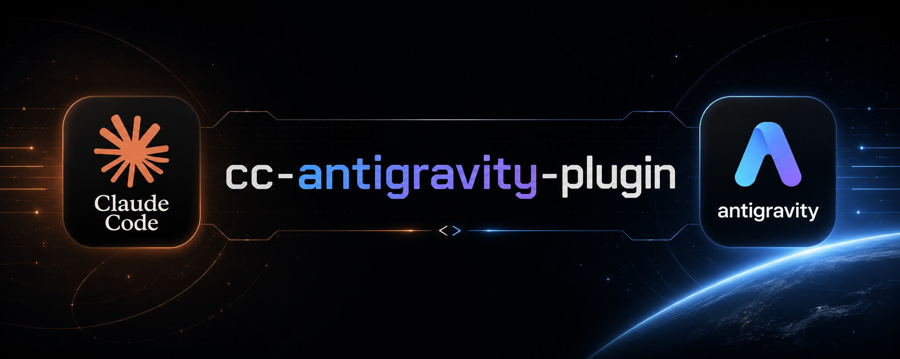

<p align="center">
  
</p>

# cc-antigravity-plugin

A plugin for Claude Code and Codex that integrates the [Antigravity CLI (AGY)](https://antigravity.google) as an agentic coding assistant — creates, edits, searches files, and executes commands autonomously over your codebase.

📖 **Documentation in other languages:**
- [Português (Brazilian Portuguese)](./README.pt-BR.md)

> **Fork:** This plugin is a fork of [gemini-cli-plugin](https://github.com/google-gemini/gemini-cli), originally created by [thepushkarp](https://www.linkedin.com/in/thepushkarp) for process automation with Gemini CLI.

## Overview

AGY is Google's long-context CLI terminal (2M token window). This plugin bridges AGY to Claude Code and Codex via a shared Node.js bridge, exposing AGY as a [tool_use](https://www.anthropic.com/research/tool-use) endpoint that Claude can invoke.

**When to use instead of native Claude Code:**
- Multi-file refactorings needing broad repository context
- Code generation spanning multiple project layers
- Architecture analysis and change impact with complete context
- Tasks benefiting from Gemini Pro deep-reasoning models
- Multiple independent deliverables that can run in parallel via native Gemini subagents (`--parallel`)

### Claude invoking `agy` directly vs via plugin

Claude can call `agy` directly via Bash (`agy --print "task" --dangerously-skip-permissions --add-dir .`) without any intermediary. However, the plugin delivers capabilities that raw `agy` cannot:

| Capability | `agy` direct | Via plugin (bridge) |
|---|---|---|
| Headless model selection | Native `--model` | Runtime catalog, aliases, 24-hour cache, and safe fallback |
| Guaranteed coding-agent behavior | No — AGY tends to respond in text | Yes — `<constraints>` block instructs use of `write_to_file`, `grep_search`, etc. |
| Structured quota/auth signals | JSON envelope | Exit codes 10/11 + normalized JSON signal with conversation/usage |
| Automatic file ingestion | Manual | `--dirs`, `--files` with binary detection and truncation |
| Parallelism via Gemini subagents | Manual | `--parallel` + optional NDJSON progress (`--format stream-json`) |
| Windows CLI limit bypass | Silent breakage | Stdin streaming (`--use-stdin`) / auto-fallback avoiding dropped files |
| Auditable logging | No | JSONL in `%LOCALAPPDATA%\agy\cc-plugin-logs\` |
| Process overhead | None | Node.js async child process; ConPTY only for `--interactive` |
| Visibility of AGY actions | Full — direct output | Black box — Claude doesn't validate before exec |
| Quota dependency | Claude only | Claude + AGY/Gemini |

**Summary:** for automated workflows, skills, and coding tasks where consistent agentic behavior is required, the bridge is the right choice. For simple ad-hoc invocations, raw `agy` suffices.

## AGY CLI 1.5 support (plugin 4.7.0)

Reviewed against the official releases through AGY 1.5.16 (baseline still 1.1.8;
below 1.5.0 the bridge keeps its legacy defaults and warns once).

- **Permissions — Auto mode by default.** Without `--mode`, `--skip-permissions`, or
  `--read-only`, the bridge uses `--mode auto` (no bypass) where AGY offers it: AGY
  1.3.5+ on Linux/macOS, AGY 1.4.4+ on Windows 11 24H2+ (build 26100). AGY 1.5.16 does not
  fail when Auto is unavailable for the account (Gemini Enterprise, Linux without user
  namespaces): it warns and continues in the default mode, where headless runs auto-deny
  every permission. The bridge stops such a run at the warning, before any step, retries
  once with `--dangerously-skip-permissions`, and remembers that for 24h per AGY version.
  Elsewhere the bypass stays the default; since AGY 1.5.2 it still blocks commands on the
  system denylist. Explicit flags always win, and explicit `--mode auto` never falls back.
- **No time ceiling by default.** AGY 1.5.0+ headless runs without `--print-timeout` wait
  until the turn and its non-daemon background tasks and subagents finish, so the bridge
  no longer sends one. A stall watchdog (`--stall-timeout`, default `15m`, `0` disables)
  stops runs that emit no progress: the bridge reads AGY's `stream-json` internally
  (also with `--json-schema`) and rebuilds the requested `json`/`text` output unchanged.
  `--timeout <duration>` is a hard ceiling; the bridge waits 30 seconds longer than AGY so
  AGY can report the partial turn first.
- **Claude Code's Bash tool** stops commands after 2 minutes by default (10 at most).
  Launch long tasks with `run_in_background: true` and `--output-file <path>`.
- **Early-end classification.** `finished_reason: "print_timeout"` (AGY 1.4.11+), the
  `[agy] print timeout after ...` stderr line, or an `AGY_ERROR` with
  `"reason":"print_timeout"` map to exit 12 and keep the partial `response`, the
  conversation ID, and `finished_reason` in the signal. `interrupted` is a failure (exit 1).
  AGY 1.5.10 spend-cap, prepaid-balance, and weekly-quota stops map to exit 10.
- **`-r` / `--resume <id>`** (AGY 1.5.16) are accepted and forwarded as `--conversation`.
- **Gemini 4 models.** `gemini-4-<family>-<tier>` slugs sort as the newest generation and
  resolve by family (`--model hydrogen`, `neon`, `argon`, `carbon high`), plus
  `--model orchestrator` (`orchestrator neon`/`argon` pick the planner). The emergency
  fallback catalog is unchanged; the runtime `agy models` catalog stays authoritative.
- **Search tools.** AGY 1.5.16 loads `grep_search`, `find_by_name`, `list_dir`, and
  `view_file`; prompts no longer point the agent at `code_search`.
- AGY 1.5.16 discovers cross-tool skills in `~/.agents/skills`, and `agy plugin import`
  converts Claude Code plugins. This plugin delegates work to AGY, so keep running it from
  Claude Code: inside AGY it would delegate AGY to itself.
- Bug fix: an `AGY_ERROR` with an unmapped status and a quota message threw a
  `ReferenceError` (exit 1) instead of exiting 10.

## AGY CLI 1.4 support (plugin 4.6.0)

- `--mode auto` enables AGY's command review on Linux/macOS (AGY 1.3.5+; Windows 11
  24H2+ with AGY 1.4.4+ since plugin 4.7.0). It disables the permission bypass and
  conflicts with `--skip-permissions`.
  Headless runs cannot answer approval prompts; use `--interactive` for manual review.
- `--effort` also accepts `xhigh` and `max` when the selected model supports them.
- Exact base model slugs such as `--model gemini-3.8-flash` preserve AGY's default
  effort (AGY 1.3.4+). Generic `--model opus` / `--model sonnet` follow the runtime
  catalog, including Claude 5.5 when available to your account and authentication.
  A missing requested generation triggers one catalog refresh and never silently
  downgrades to an earlier generation.
- `--json-schema` requires JSON with an object root (`"type": "object"`), inline
  or in a file. Invalid inputs fail before model discovery or task execution.
- Structured `AGY_ERROR` diagnostics on stderr are normalized across text, JSON,
  and stream-json. Quota/auth/timeout map to 10/11/12; other structured failures
  map to 1 with upstream metadata in `agy_error` and any structured partial `response`.
  A partial response is never a successful result when the CLI reports an error.
- Workspace prompts used available search tools such as `code_search` (superseded in
  4.7.0: AGY 1.5.16 loads `grep_search`, `find_by_name`, and `list_dir` again).

In 4.6.0 the bridge kept an explicit 10-minute timeout (since 4.7.0 it applies only to
AGY older than 1.5.0). AGY 1.2.6+ itself defaults to unlimited.
AGY 1.3.2+ permission bypass no longer auto-approves plan artifacts; configure
Artifact Review in AGY if needed. Native terminal shortcuts, Remote Control,
OSC 7501 status, and AGY marketplace management remain native CLI features.
`agy plugin validate --strict --json` validates **AGY** plugins; this repository
continues to use the Claude Code plugin manifest.

Sources: [AGY releases](https://github.com/google-antigravity/antigravity-cli/releases),
[effort reference](https://antigravity.google/docs/cli/commands/effort/).

## Version 4.0 migration

Version 4.0 targets AGY 1.1.8+ and realigns bridge flags with the CLI:

- `--agent` now requires an agent name (`--agent code-reviewer`). Use `--interactive`
  for a PTY session; the old alias behavior was removed.
- Headless output defaults to JSON and disables slash-command expansion. Use
  `--format text` or `--allow-slash-commands` to opt back into the old behaviors.
- Models are passed through native `--model`; the bridge never edits AGY `settings.json`.
- `--generate-image` invokes the `generate_imagem` tool and no longer invents a
  `nano-banana` model slug.

## Prerequisites

- **Node.js 22+**
- **Antigravity CLI 1.1.8+** installed and authenticated (AGY 1.5.16 recommended)

```bash
# macOS / Linux
curl -fsSL https://antigravity.google/cli/install.sh | bash

# Windows PowerShell
irm https://antigravity.google/cli/install.ps1 | iex
```

After installing, run `agy` once to log in and verify it works:

```bash
agy --print "what is 2+2"
```

> The `SessionStart` hook automatically checks if AGY is installed and accessible on each Claude Code session start.

## Installation

### Claude Code (recommended)

**Via CLI (terminal):**

```bash
# Add the GitHub repository as a marketplace source
claude plugin marketplace add AllanHarlen/cc-antigravity-plugin

# Install the plugin — the name after "@" is the marketplace's internal
# name (from marketplace.json), not the GitHub "owner/repo" path
claude plugin install cc-antigravity-plugin@cc-antigravity-plugin
```

**Via slash command (inside Claude Code):**

```
/plugin marketplace add AllanHarlen/cc-antigravity-plugin
/plugin install cc-antigravity-plugin@cc-antigravity-plugin
```

**To test a local copy of the repository:**

```bash
cc --plugin-dir /path/to/cc-antigravity-plugin
```

### Codex

```bash
git clone https://github.com/AllanHarlen/cc-antigravity-plugin.git \
  ~/.agents/skills/cc-antigravity-plugin
```

Restart Codex after cloning.

## Usage

### Correct Entry Point

For any coding request (creating, editing, deleting, moving, or formatting
files), always use the direct command/skill path:

```bash
/cc-antigravity-plugin:antigravity --parallel --add-dir ./frontend "implement the requested components"
```

Do not use `antigravity-agent` for coding. That agent is read-only and exists
only for analysis, planning, audits, and refactor-impact work.

If you specifically want the coding run tracked by the harness as a subagent,
use the **`antigravity-coder`** agent instead of the read-only one. It is the
sanctioned subagent path for implementation: it has no `Write`/`Edit` and no
broad `Bash` — its only file-acting tool is the bridge, so AGY/Gemini performs
the file generation and it does not spend Claude tokens writing file contents.
The plain command/skill path remains the simplest option when you do not need a
separate subagent layer.

**This policy ships with the plugin — no personal rules file needed.** A
`SessionStart` hook injects the coding-delegation policy (delegate file work to AGY,
`--parallel` for large front-end, model guidance, and the front-end image
`AskUserQuestion` flow) as session context automatically. Turn it off with the
`coding_policy` plugin option (set it to `off`).

In monorepos, the recommended pattern is to keep Claude Code responsible for the
back-end, containers, and validation, while all front-end work goes to AGY via
`/cc-antigravity-plugin:antigravity --parallel --add-dir ./frontend`. See UC13 in
[`CASOS_USO.md`](CASOS_USO.md).

```bash
# Agentic task — default, creates and edits files in workspace
/cc-antigravity-plugin:antigravity "Refactor the auth module for async/await and update all callers"

# With inline directory context
/cc-antigravity-plugin:antigravity --dirs src,docs "Explain the architecture and cite key files"

# Analysis only, no file modifications
/cc-antigravity-plugin:antigravity --read-only --dirs src "Analyze the impact of removing the cache module"

# Specific model and explicit effort
/cc-antigravity-plugin:antigravity --model gemini-3.7-flash-high --effort high "Design the database schema for module X"

# Auto model (selected by inline context size)
/cc-antigravity-plugin:antigravity --model auto --dirs src "Refactor the controllers"

# Parallel subagents — AGY splits task into native concurrent Gemini subagents
/cc-antigravity-plugin:antigravity --parallel "Create two HTML reports in reports/: electric vehicle taxes and ICE vehicle taxes in Brazil"

# Parallel subagents with live NDJSON progress on stderr
/cc-antigravity-plugin:antigravity --format stream-json --parallel --subagent-model gemini-3.7-flash-medium "Generate three independent React components: Header, Sidebar, and Footer"

# Resume previous session
/cc-antigravity-plugin:antigravity --continue "Continue from step 3 of the previous refactoring"

# Image generation through AGY's generate_imagem tool
/cc-antigravity-plugin:antigravity --generate-image "a futuristic skyline at sunset, cyberpunk style, purple and orange tones"

# With style context and destination directory
/cc-antigravity-plugin:antigravity --generate-image --files "brand/style.json" --output-dir ./assets "logo following the visual identity guide"
```

In Codex, use the skill:

```text
$antigravity-integration <task>
```

## Options

| Option | Description |
|---|---|
| `--dirs <path,...>` | Recursively inject directories as inline context in the prompt |
| `--files <glob,...>` | Inject files matching comma-separated globs |
| `--priority-files <path,...>` | Relative paths to keep ahead of the `--max-files` cutoff. Without it, files are kept in plain alphabetical order, so a large match set silently drops whatever sorts last. |
| `--design-system <dir,...>` | Hand one or more Open Design packages to AGY without truncation (uses `<dir>/resolved` when present). Core files — `design-contract.json`, `DESIGN.md`, `tokens.css`, `components.html`, `USAGE.md`, `components.manifest.json`, `assets/manifest.json` — are inlined in full, ahead of and outside `--max-files`/`--max-file-bytes`; other package files are listed for on-demand `view_file` reads. Adds a `<design_system>` block that marks the package as authoritative and keeps its name out of product copy. |
| `--add-dir <path>` | Add directory to AGY's native workspace via `--add-dir`; repeatable |
| `--model <name>` | Native AGY slug or alias resolved from `agy models`; omitted by default to preserve the user's AGY `/model` |
| `--format <format>` | `text`, `json`, or `stream-json`; JSON is the headless default |
| `--effort <level>` | Native `low`, `medium`, `high`, `xhigh`, or `max` (model-dependent); forwarded only when requested |
| `--mode <mode>` | Native `plan`, `accept-edits`, or `auto` (AGY 1.3.5+ on Linux/macOS, 1.4.4+ on Windows 11 24H2+); Auto mode disables permission bypass |
| `--agent <name>` | Select a custom AGY agent; no longer aliases interactive mode |
| `--json-schema <value>` | Object-root JSON Schema string/file; validated before AGY starts; implies JSON output |
| `--allow-slash-commands` | Re-enable slash-command expansion (disabled by default headless) |
| `--parallel` | Allow AGY to split the task among multiple native Gemini subagents (`DefineSubagent` / `invoke_subagent` / `ManageSubagents`). AGY decides how many. Works in default headless mode. |
| `--subagent-model <name>` | Model for spawned subagents (passed via prompt — AGY has no per-subagent CLI flag). Enables `--parallel` automatically. Default: model of main session. |
| `--read-only` | Forces native `--mode plan`, disables skip-permissions/cwd auto-add, and keeps slash expansion enabled because AGY 1.1.16 otherwise ignores plan mode. The prompt restricts inspection to the read-only search tools AGY loaded (`grep_search`, `find_by_name`, `list_dir`, `view_file` on AGY 1.5.16): headless runs cannot approve the `command` permission, so a `run_command` call is auto-denied and aborts the analysis (4.4.3) |
| `--continue`, `-c` | Resume the most recent AGY conversation |
| `--conversation <id>`, `-r`, `--resume` | Resume a specific AGY conversation by ID |
| `--timeout <duration>` | Hard ceiling passed as `--print-timeout` (e.g., `30m`). Default: none on AGY 1.5.0+ (`0` also means none); 10 minutes on older CLIs. |
| `--stall-timeout <duration>` | Runs without a ceiling: stop AGY with exit 12 after this long without any progress event. Default `15m`; `0` disables. Also `stall_timeout` in the plugin config. |
| `--output-file <path>` | Write the parsed final response to a file instead of stdout |
| `--task-file <path>`, `--prompt-file <path>` | Read task text from a file instead of argv. Protects the caller-to-bridge hop from OS command-line limits. |
| `--use-stdin`, `--stdin` | Force streaming the prompt to AGY over stdin instead of `--print <prompt>`. Automatic for headless prompts above 8,191 chars on Windows and 100,000 chars elsewhere, so inline context is never dropped for size. `--interactive` always passes the prompt in argv; there, the lowest-priority inline files are dropped first to fit the Windows limit. |
| `--dump-prompt <path>` | Write the exact prompt sent to AGY for this run to `<path>`, plus a JSON sidecar at `<path>.audit.json` with `{ promptChars, limit, transport, degraded, droppedFiles, included, skipped, designSystems }`. Reflects the real run (post prompt-overflow fallback), not a dry run. Prints `BRIDGE_CONTEXT_REPORT: <path>.audit.json` to stderr. |
| `--interactive` | Use `--prompt-interactive` with PTY/ConPTY (requires TTY) |
| `--sandbox` | Enable AGY sandbox mode |
| `--max-files <n>` | Maximum `--dirs`/`--files` files injected as inline context (`--design-system` core files are exempt). Default: `40` |
| `--max-file-bytes <n>` | Maximum bytes per file. Default: `32768` |
| `--generate-image`, `--generate-imagem` | Generate an image with AGY's `generate_imagem` tool without changing models |
| `--output-dir <path>` | Directory where generated images are saved. Default: current directory. |

Image generation is fail-closed: one invocation must resolve exactly one new
image. Success emits `AGY_IMAGE_RESULT` with destination, byte count, SHA-256,
MIME type, dimensions, and aspect ratio. Zero or multiple candidates, invalid
image bytes, extension mismatches, and an explicit requested aspect ratio outside
tolerance fail; a different existing destination is never overwritten.
| `--print-command` | Print the resolved `agy` command without executing |

**Agentic defaults:** cwd is added to AGY's workspace via `--add-dir`, and AGY acts without confirmation prompts — through Auto mode where AGY offers it, otherwise `--dangerously-skip-permissions` (see "AGY CLI 1.5 support"). Use `--read-only` to disable.

**`--read-only` trade-off:** AGY 1.1.16 ignores `--mode plan` while slash-command expansion is disabled, so `--read-only` re-enables that expansion to keep the stronger no-write guarantee. This means slash-command/skill expansion runs on the read-only path — the one most often used to analyze untrusted repository content — where a normal headless run would keep it off. There is no known way to neutralize this without weakening the no-write guarantee it exists to protect, since it is AGY's own behavior, not something the bridge parses. Prefer `--dirs`/`--add-dir` over pasting untrusted content directly into the task text when running `--read-only` against a repository you do not control.

## Available Models

The bridge discovers the current catalog with `agy models`, caches it for 24 hours,
and falls back to a built-in emergency list only when discovery fails. With AGY 1.5.16
the catalog includes `gemini-4-{hydrogen,neon}-{low,medium,high,xhigh}`,
`gemini-4-{argon,carbon}-{low,medium,high}`, `gemini-pro-orchestrator[-argon|-neon]`,
`gemini-3.8-flash-*`, `claude-{opus,sonnet}-5-5-*`, and `gpt-oss-120b-medium` (the exact
list depends on your account). Bare aliases such as `flash`, `opus`, `sonnet`, `hydrogen`,
`neon`, `argon`, `carbon`, and `orchestrator` resolve to the newest matching runtime member.

**`--model auto` — thresholds:**

| Total inline context | Selected model |
|---|---|
| < 32 KB | newest Flash family, low tier |
| 32 KB – 256 KB | newest Flash family, medium tier |
| ≥ 256 KB | newest Flash family, high tier |

The resolved slug is passed through native `--model`. When `--model` is omitted, AGY's
configured model remains in control. The bridge never reads or writes `settings.json`.

## Parallel Subagents (`--parallel`)

AGY exposes native subagent tools (`DefineSubagent`, `invoke_subagent` / `Agent`, `ManageSubagents`) that allow you to **fan-out work within a single `agy` session** — multiple independent tasks run concurrently under a single model context.

With `--parallel`, the bridge attaches an instruction block to the prompt authorizing AGY to decompose the task into independent subtasks and execute them concurrently. **AGY itself decides how many subagents to spawn** (subject to rate limits).

```bash
# AGY decides the number of subagents
/cc-antigravity-plugin:antigravity --parallel "Create two independent HTML reports in reports/"

# Live tool/subagent progress on stderr
/cc-antigravity-plugin:antigravity --format stream-json --parallel --subagent-model gemini-3.7-flash-medium "Generate three independent components"
```

**Details:**
- `--subagent-model` enables `--parallel` automatically and is transmitted via **prompt text** (AGY has no per-subagent CLI flag). Without it, subagents inherit the session model.
- Works in default headless mode (`--print`) — no TTY required.
- Ideal for **independent deliverables** (multiple reports, components, or files). For sequential steps or state-sharing, keep execution on the main agent.
- Without the flag, the prompt remains identical to default behavior — zero impact on existing calls.
- `--parallel` is ignored when combined with `--generate-image`.

## Exit Codes

The bridge emits structured JSON for orchestrators to react to failures:

```json
{"status":"QUOTA_EXAUSTED","reason":"...","model":"gemini-3.7-flash-high","conversation_id":"...","usage":{},"retry":"--conversation ..."}
```

The `retry` field uses the exact conversation ID when AGY returned one; otherwise it falls back to `--continue`.

| Code | Meaning | Action |
|---|---|---|
| `0` | Success | — |
| `1` | Generic error | Check the log |
| `10` | `QUOTA_EXAUSTED` | Wait for reset; use the emitted `retry` command (also spend-cap, prepaid-balance, weekly quota) |
| `11` | `AUTH_REQUIRED` | Run `agy` interactively once |
| `12` | `TIMEOUT` | `--timeout` expired (partial `response` kept) or the stall watchdog fired; raise `--timeout`/`--stall-timeout` or reduce scope |
| `13` | `AGY_MISSING` | Install AGY |

> **Watchdog:** without `--timeout` (AGY 1.5.0+), the timer resets on every AGY progress event and only fires after `--stall-timeout` (15m) of silence. With `--timeout`, AGY enforces the ceiling and the bridge's own timer waits 30 seconds longer so AGY can report the partial turn.

## Tests

```bash
npm test
```

```
ℹ pass 100+
ℹ fail 0
```

Coverage: argument parsing · context collection · prompt generation · dynamic model cache/fallback · JSON envelopes · incremental NDJSON · async headless spawn · interactive ConPTY · timeout heartbeat · read-only mode · exit codes.

For practical usage examples in real scenarios, see [`CASOS_USO.md`](CASOS_USO.md) — 13 use cases covering architecture analysis, multi-file refactoring, documentation generation, parallel task decomposition, image generation, and monorepo delegation.

## Development

### Future work (not included in 4.0)

`--input-format stream-json`, `--project` / `--new-project`, `--log-file`, AGY MCP
management commands, and API-key/provider configuration remain intentionally outside
the bridge surface for this release.

### Environment Variables

| Variable | Description |
|---|---|
| `CC_ANTIGRAVITY_LOG_PATH` | Custom path for the JSONL log file |
| `CC_ANTIGRAVITY_LOG_OUTPUT` | Set to `1` to include AGY output in logs |

Default log: `%LOCALAPPDATA%\agy\cc-plugin-logs\plugin-YYYY-MM-DD.jsonl` (Windows) or `~/.local/share/agy/cc-plugin-logs/` (Linux/macOS).

**Content and retention:** one file per day, written by `logEvent()` (`scripts/utils.js`), never pruned automatically. Every entry records the file paths passed as context (`--dirs`/`--files`); with `CC_ANTIGRAVITY_LOG_OUTPUT=1` it also records AGY's raw output chunks, which may include response content derived from your codebase. Delete old files under the log directory manually, or point `CC_ANTIGRAVITY_LOG_PATH` at a location your own retention policy already manages.

### Local testing with real-time logs (Windows)

```powershell
.\scripts\run-claude-plugin-dev.ps1
```

The script sets `CC_ANTIGRAVITY_LOG_PATH` for the session and opens a second window with `Get-Content -Wait` on the log.

## Troubleshooting

| Problem | Solution |
|---|---|
| Authentication error | Run `agy` interactively and log in. |
| `agy` not found | Run the AGY installer and confirm the binary is in PATH. |
| Model not changing | Run `agy models`, pass a listed slug, and inspect `--print-command`; unknown slugs are intentionally omitted with a valid-model warning. |
| Token pressure | Reduce `--dirs`, restrict `--files`, or lower `--max-files`. |
| Premature timeout | Increase `--timeout`. With heartbeat active, timer resets per output — verify AGY is producing output. |
| Plugin not loaded | Run `/reload-plugins` or restart Claude Code. |
| Wrong encoding file skipped | Non-UTF-8 files (e.g., Windows-1252) are skipped with `encoding-error`. Re-save as UTF-8. |

## License

[MIT](LICENSE)
